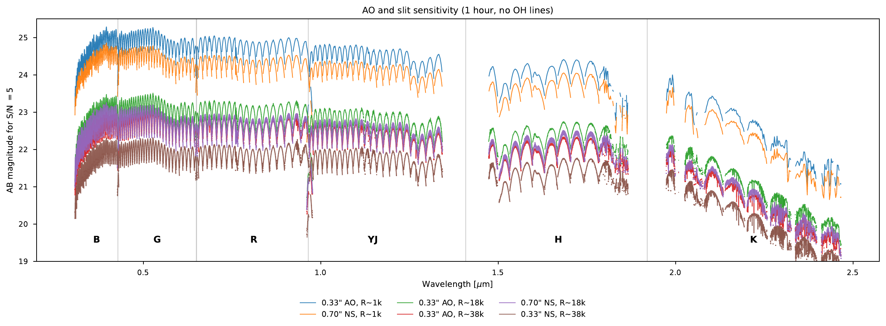
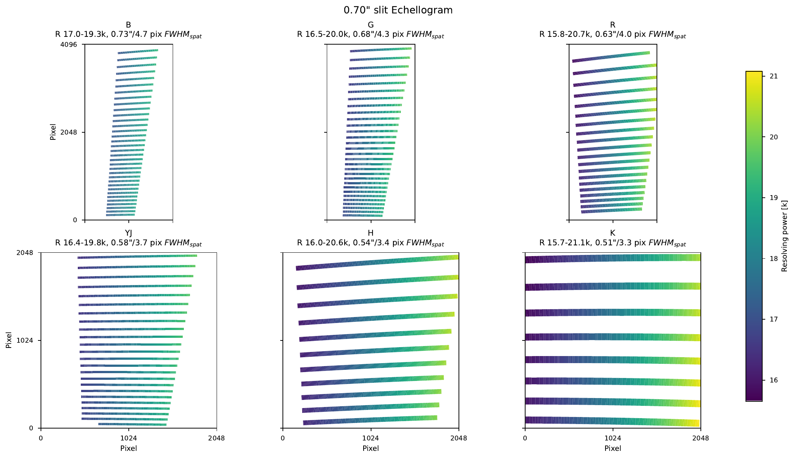
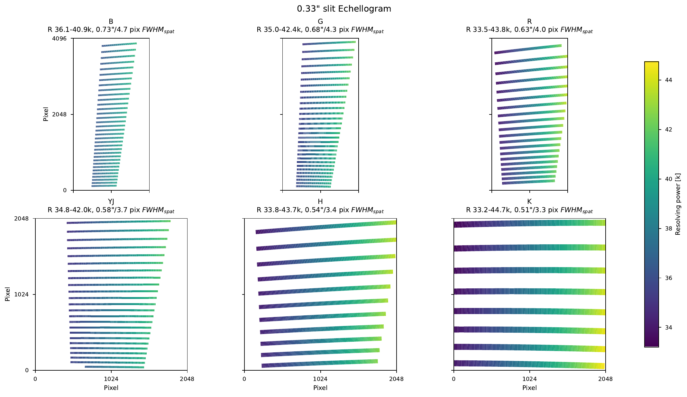
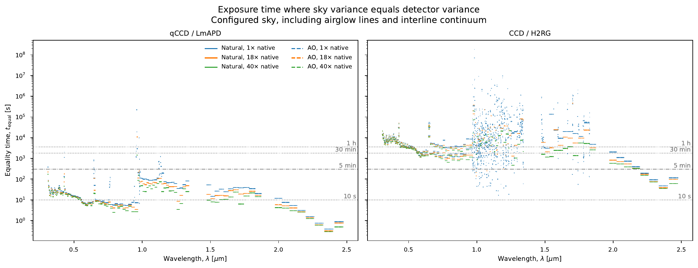
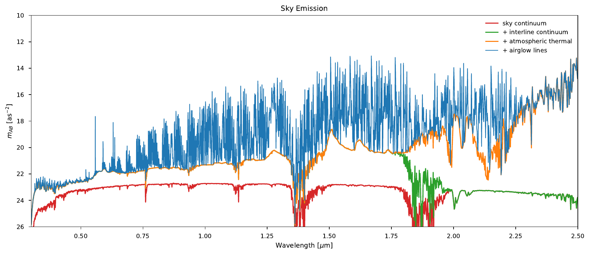

# Performance

ZSpec covers 0.31–2.45 µm at native resolving powers of approximately 18,000 with a 0.70″ slit and
38,000 with a 0.33″ slit. The dark-time model reaches **24.49 AB in VIS and 23.87 AB in YJH at
R≈1,000 in one hour**, increasing to **24.93 and 24.33 AB with seeing enhancement**.

**ZSpec conditions:** airmass 1.1; natural seeing 0.65″; a flat-fν point source; S/N=5 per reported
resolution element. One hour is two 1,800-second exposures; five minutes is one 300-second exposure.
Times are on source; the noise budget includes an equal-duration independent sky reference.

## Limiting magnitude

[](_static/image/performance/limiting-magnitude.png)

One-hour limits with **OH-line emission disabled**, comparing the 0.70″ and 0.33″ slits in natural
seeing and the 0.33″ slit with AO. The table below includes OH emission with a S/N-optimized boxcar
extraction.

**Limiting magnitude (AB; OH included, S/N optimized)**

| R (approx.) | Slit / image | 1 h VIS | 1 h YJH | 5 min VIS* | 5 min YJH* |
| --- | --- | ---: | ---: | ---: | ---: |
| 1,000 | 0.70″ / natural seeing | 24.49 | 23.87 | 23.1 | 22.5 |
| 1,000 | 0.33″ / AO | 24.93 | 24.33 | 23.4 | 22.* |
| 9,000 | 0.70″ / natural seeing | 23.29 | 22.79 | 21.8 | 21.4 |
| 9,000 | 0.33″ / AO | 23.67 | 23.15 | 22.1 | 21.7 |
| 18,000 | 0.70″ / natural seeing | 22.90 | 22.43 | 21.4 | 21.0 |
| 18,000 | 0.33″ / AO | 23.26 | 22.78 | 21.6 | 21.3 |
| 38,000 | 0.33″ / natural seeing | 22.3* | 22.0* | 20.6 | 20.4 |
| 38,000 | 0.33″ / AO | 22.81 | 22.38 | 21.2 | 21.0 |

VIS and YJH are means of the B/G/R and YJ/H channel limits, respectively. The limits summarize
favorable portions of the orders; they are not coadded broadband magnitudes. K is about 1.4 mag
shallower than YJH in the one-hour calculation.

\* Conservative estimates where the result is not fully OH-optimized result: five-minute values use the
corresponding one-hour OH penalty.

### Seeing-enhancement gain

- **R≈1,000:** +0.44 mag in VIS and +0.46 mag in YJH for the one-hour comparison.
- **R≈18,000:** +0.36 mag in VIS and +0.35 mag in YJH.
- The AO cases use the 0.33″ slit and the notebook's effective PSF, approximately 0.31″ FWHM in the
  red and NIR. The sharper STRATA predictions and the telescope/VIS focus strategy are described
  under [Seeing Enhancement](seeing_enhancement.md). These are conservative gain estimates owing to both dark time
  computation and adopting a conservative approach to ensuring AO does not cause sub-Nyquist sampling.

(zimager-performance)=
## ZImager

The simulator also supports ZImager's three imaging channels. The current middle-band calculation
reaches **about 27.0 AB at S/N=5 in five minutes**, with 0.65″ natural seeing, airmass 1.1, and dark
sky.

(spectral-resolution)=
## Spectral resolution

The 0.70″ slit gives R=15,700–21,100 across the six channels; the 0.33″ slit gives R=33,200–44,700.
Anamorphic magnification changes resolution along each order. The plots show the actual detector
formats: 2k×4k in B/G/R and 2k×2k in YJ/H/K.

::::{tab-set}
:::{tab-item} 0.70″ slit
[](_static/image/performance/resolution-070.png)
:::
:::{tab-item} 0.33″ slit
[](_static/image/performance/resolution-033.png)
:::
::::

## Detector break-even time

[](_static/image/performance/detector-break-even.png)

For the 0.33″ slit, representative native-resolution samples in natural seeing reach sky/detector
variance equality in **29 s at 370 nm with qCCD** and **17 s at 1.65 µm with LmAPD**. The
conventional-detector comparison gives 2.3 h and 52 min, respectively. Both include the configured
OH sky; the conventional CCD calculation includes on-chip binning.

## Sky levels

[](_static/image/performance/sky-levels.png)

The model adds astronomical continuum, interline continuum, atmospheric thermal emission, and
airglow lines. At R≈1,000, S/N-based selection retains about 83% of native wavelength samples in YJ
and 73% in H for natural seeing, rising to 90% and 84% with AO.

The [instrument simulator](simulator.rst) contains the saved calculations and diagnostic plots.

:::{container} zs-internal-only

**Sources and calculation notes**

- [Dark-time performance notebook](_staged/sim/notebooks/zshooter_performance.ipynb), merged in
  simulator commit `6a616ea`. Saved run: `d383ad2-dirty`, IRDB `d1415c4`, ScopeSim `0.11.5a3`.
  Figures are the saved PDFs converted to PNG; no simulations were rerun for this page.
- The ZImager estimate comes from the saved dark-time `06_ZImager.ipynb` working copy: 26.97 AB
  in the middle band, using aperture photometry with background-dominated noise and a local sky
  annulus. This notebook is not yet in the website's simulator submodule.
- The one-hour table uses the notebook's **OH included, S/N optimized** summary: mean magnitude in
  each order's best 25% of complete bins, then median across orders. VIS/YJH are arithmetic means of
  the channel summaries. The notebook prose still says 20%; the executed cell and saved output use
  25%.
- Estimated entries apply the difference between the saved one-hour OH-disabled and OH-optimized
  limits to the corresponding OH-disabled case. The missing natural-seeing 0.33″ native-resolution
  row uses the AO 0.33″ correction: 0.01 mag in VIS and 0.02 mag in YJH. Replace these estimates
  when matched calculations are available.
- The AO forecast still uses `ao_table.dat`, with an effective red/NIR FWHM near 0.31″. Update it
  with the telescope-defocus and relative VIS-focus prescription before claiming sensitivity for the
  sharper STRATA PSFs.
- The science-review slides and SPIE 2026 paper/talk supply the presentation structure. Their older
  grey-time limits and detector-loss summaries are superseded here by the saved dark-time run.

:::

```{toctree}
:hidden:
:maxdepth: 1

seeing_enhancement
simulator
```
