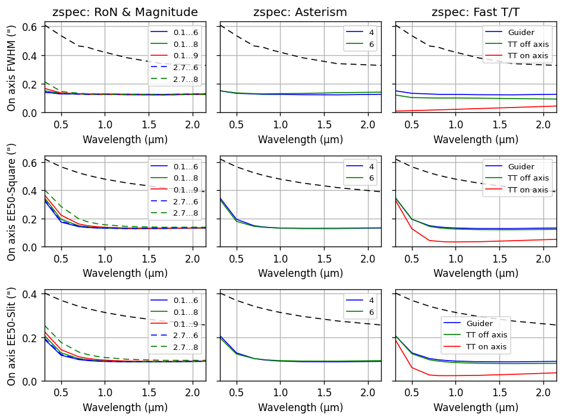
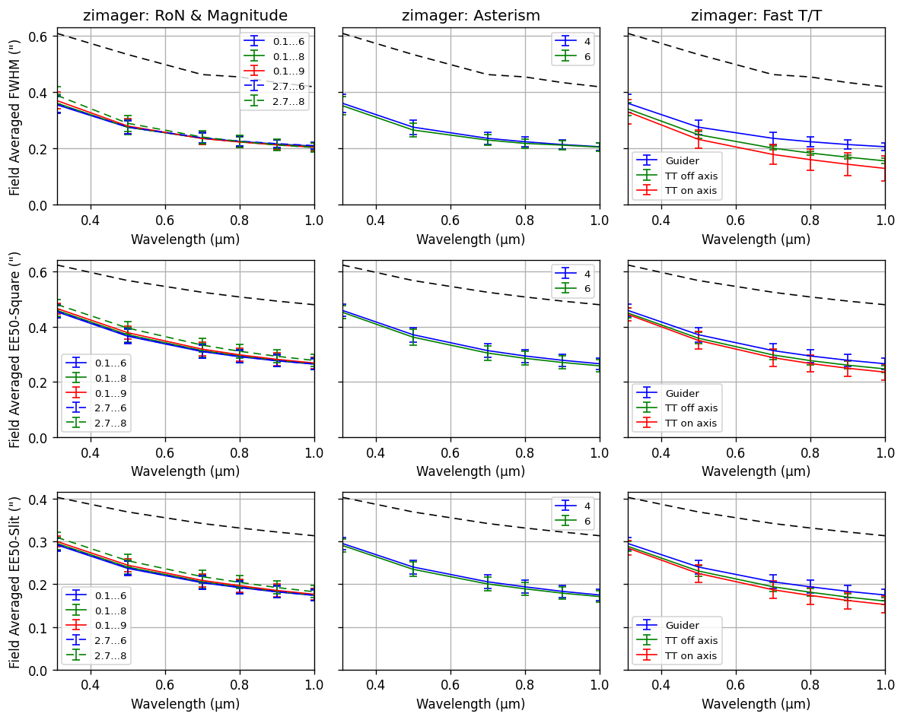

# Seeing Enhancement

STRATA, the planned adaptive-optics system using Keck I's adaptive secondary, will concentrate light
for ZShooter spectroscopy and imaging. ZShooter will also operate in natural seeing.

## Performance overview

| Science path | Image-quality estimate | Field used in the AO model |
| --- | --- | --- |
| ZSpec | Approximately 0.15″ FWHM in R–K, before deliberate defocus to match spectrograph sampling | On-axis correction |
| ZImager | Field-averaged FWHM of approximately 0.35–0.4″ at 0.31 µm, improving to approximately 0.2″ at 1 µm | A 3′-diameter circular correction field |

The ZImager values are approximate readings of the September simulation curves below. The correction
field differs from the camera's detector footprint.

The baseline uses four laser guide stars in a square asterism: 15.2″ in diameter for ZSpec and 50″
for ZImager. It includes facility guiding without requiring a bright star for fast, on-axis tip/tilt
sensing. Six lasers give little improvement in these cases. Fast tip/tilt correction gives its
largest gain with an on-axis star in the narrow ZSpec field.

## Matching the PSF to the spectrograph

1. **Set the NIR reference with telescope focus.** Defocus the telescope so the PSF's EE80 matches
   the NIR Nyquist slit width.
2. **Tighten the VIS image with relative focus.** Adjust the VIS/NIR relative-focus mechanism for
   the VIS slit, balancing U-band losses against R-band gains.
3. **Calibrate focus and slit coupling.** Measure focus curves and wavelength-dependent slit
   throughput through the {ref}`telescope and relative-focus calibration <c10>`.

This replaces the flat tip/tilt-error allowance used in the older SPIE simulations. The AO plots
below report **EE50**; the focus prescription needs EE80 evaluated directly from the PSFs for the
slit geometry.

## Considerations for ZShooter

- **Simulation scope:** median turbulence, 30° zenith angle, 600 Hz sampling, and 10-second
  simulations averaged over four turbulence seeds. Windshake and vibration are included; instrument
  implementation errors are not.
- **Guide stars:** establish brightness limits, truth-sensing needs, and sky coverage for the
  optional fast tip/tilt correction.
- **Laser/WFS:** 25 W-class lasers suffice at the modeled sodium return, wavefront-sensor
  throughput, and read noise. More lasers or faster sampling give limited gains when residual
  tip/tilt dominates.
- **RNAS dichroic:** the modeled laser pickoff avoids vignetting the science field and helps reject
  Rayleigh backscatter. Its transmission, chromatic effects, wavefront error, and ghosts remain
  inputs to the ZShooter budgets.
- **PSF mapping:** evaluate correction across ZImager's actual bands and rotating detector
  footprint, and evaluate the VIS focus trade between U-band losses and R-band gains.

## Simulation results

### ZSpec

ZSpec on-axis predictions. Rows show FWHM, the square width enclosing 50% of the energy, and the
slit width enclosing 50%. Columns compare laser signal/read noise, laser count, and tip/tilt
configuration. Dashed black curves show the uncorrected case.

### ZImager

ZImager predictions averaged over the 3′-diameter field, with the same metrics and comparisons as
ZSpec. Error bars show variation across the field.

:::{container} zs-internal-only

**Sources**

- Lianqi Wang, *STRATA Simulation Configuration and Results*, 26 September 2026, version 2: slides
  2–3, 11–17, and 34–35. Figures reproduced from slides 11 and 15.
- *STRATA MAOS Simulation Baseline Configuration and Trade Studies*, 27 August 2026: performance
  evaluation, ZSpec and ZImager configurations, conclusions, and future work.
- *ZShooter instrument paper*, SPIE 2026, Section 7 and Table 3: the earlier seeing-enhancement and
  natural-guide-star comparison. See [Publications](presentations_publications.md).
- The 0.15″ ZSpec working estimate and telescope/VIS focus strategy follow the current instrument
  direction. The [Performance](performance.md) numbers still use the saved notebook's broader
  effective AO PSF.

:::
