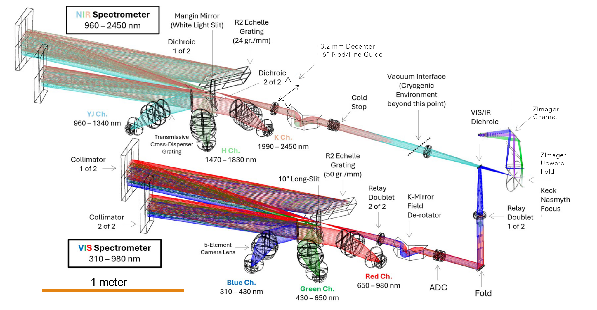
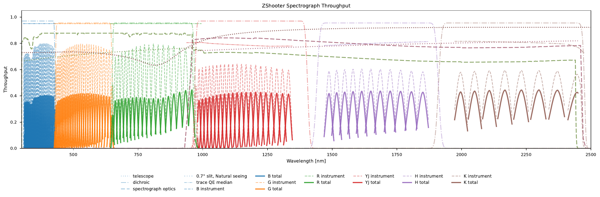

# ZSpec

ZSpec records **0.31–2.45 µm simultaneously** with two independent slit spectrometers: VIS feeds
B/G/R, and NIR feeds YJ/H/K. Each uses an asymmetric white-pupil echelle design with three
cross-dispersers, cameras, and detectors. The spectral format is fixed; slit width sets the native
resolution, and spectra can be binned after OH rejection.

## Optical layout

The integrated layout includes the two slit relays and the ZImager pickoff. The imager branch is
schematic; its current prescription is described under [ZImager](zimager_optical.md).

## Channels and spectral format

| Channel | Passband (nm) | Echelle orders | Cross-disperser (grooves/mm) |
| --- | --- | --- | ---: |
| B | 310–430 | 85–118; 34 orders | 2,000 |
| G | 430–650 | 56–85; 30 orders | 1,100 |
| R | 650–980 | 37–56; 20 orders | 625 |
| YJ | 960–1,340 | 57–80; 24 orders | 350 |
| H | 1,470–1,830 | 41–51; 11 orders | 300 |
| K | 1,990–2,450 | 31–38; 8 orders | 270 |

Each VIS channel uses a **2,048×4,096 qCCD**; each NIR channel uses a **2,048×2,048 LmAPD**. All use
15 µm pixels. The NIR gaps lie in the strong atmospheric water bands between YJ, H, and K.

## Pre-optics and slit planes

A VIS/NIR dichroic sits 275 mm behind the telescope focus in the diverging beam. It reflects VIS and
transmits NIR, with a transition near 950 nm. A packaging fold separates the two spectrometers by
approximately 850 mm.

Each arm has a 690 mm collimating doublet and a 500 mm reimaging doublet. The relay converts the
telescope's f/14.5 beam to f/10.5 and gives **530.6 µm/arcsec at the slit**. The 10″ slit is 5.3 mm
long. Each arm has its own counter-rotating Amici-prism ADC and K-mirror field derotator.

In NIR, the last element of the first doublet forms the vacuum window. The subsequent optics operate
near 100 K. A rotating cold Lyot stop at the 47.8 mm pupil masks the primary-mirror perimeter,
central obscuration, and spiders.

The steering concept decenters the final relay doublet by up to ±3.2 mm for approximately ±6″ of
nod/fine-guide motion. Separate VIS and NIR steering permits independent nod patterns. Slit-view
cameras monitor placement at both slits; they are omitted from the layout figure.

## Echelles and white-pupil relay

The first parabolic collimator has a 1,500 mm focal length and forms a **150 mm pupil** on an R2
echelle. The blaze angle is 65.6°, with 50 grooves/mm in VIS and 24 grooves/mm in NIR. A 0.6°
out-of-plane tilt separates the returning dispersed beam from the entrance slit.

The return beam passes through a silica Mangin mirror at the intermediate white-light slit. A
second, 1,250 mm collimator forms a **125 mm white pupil**, reducing the aperture required by the
channel optics. Two dichroics near that pupil divide each spectrometer into three arms. The NIR
transitions are near 1.4 and 1.9 µm.

The cross-dispersers operate in first-order transmission. The working technology is VPH, with a
volume Bragg grating option under consideration for B. The selected direct-ruled echelle approach
addresses both diffraction efficiency and scattered light between bright sky lines.

## Cameras, sampling, and resolution

Each camera is a five-element, air-spaced refractive design with **225 mm focal length at f/1.8**.
The NIR cameras use CaF₂ positive elements and silica negative elements; the VIS cameras use glasses
selected for their individual passbands.

The detector plate scale is approximately 0.157″/pixel. The current performance model gives:

| Slit width | Nominal sampling | Resolving power across the format |
| --- | --- | --- |
| 0.70″ | 4.46 pixels | 15,700–21,100; median ≈18,000 |
| 0.33″ | 2.10 pixels | 33,200–44,700; median ≈38,000 |

Anamorphic magnification changes sampling and resolving power along each order. The
{ref}`resolution maps <spectral-resolution>` show the full detector formats. With
[seeing enhancement](seeing_enhancement.md), telescope focus sets the NIR EE80 to the Nyquist slit
width, and relative VIS focus balances U-band losses against R-band gains.

## Optical verification

The optical AIT products are:

- Per-channel wavelength/format maps and line-spread functions versus wavelength, slit position, and
  slit width, tied to the integrated prescription.
- Ghost, scattered-light, and calibration-illumination maps from internal lamps and bright-line
  tests.
- Focus/thermal sensitivity measurements and repeatability measurements for slit selectors,
  rotators, pupil stops, and detector focus.
- Cross-channel registration and focus/slit-coupling measurements, developed in the
  [calibration procedures](procedures/calibration.md).

## Throughput

The solid curves include telescope transmission, dichroics, spectrograph optics, disperser
efficiency, detector QE, and the **0.70″ slit in 0.65″ natural seeing**. The dashed channel curves
show instrument throughput, including detector QE, before telescope and slit losses. Atmospheric
absorption is excluded from this figure. The visible QE follows each spectral trace across the
tapered detector coating.

[Performance](performance.md) gives the corresponding dark-time limiting magnitudes and detector/sky
comparisons.

:::{container} zs-internal-only

**Design work to close**

- **Slit inventory:** reconcile the paper's 0.30–0.70″ table, its wider prose range, and the
  presentation's 0.30–1.30″ range. The current performance cases use 0.70″ and 0.33″.
- **Steering:** verify slit-plane image quality, pupil motion, and telecentricity across the
  proposed ±6″ nod range, including the focus offsets used for seeing enhancement.
- **Image quality:** export EE80 and line-spread-function maps from the agreed integrated
  prescription across order wavelength and the 10″ slit.
- **Optics qualification:** verify B-band transmission below 350 nm, R-band fringing/scatter, and
  NIR glass/coating behavior at the operating temperature.
- **Upgrade trades:** retain prism-assisted cross dispersion and a VIS pupil slicer as studies;
  neither is included in the baseline format or throughput above.

**Sources**

- *ZShooter SPIE 2026 manuscript*, §4.1, Table 2, and Figure 5: optical prescription and channel
  inventory. The current notebook supplies the 0.33″ sampling/resolution values.
- *ZShooter SPIE 2026 presentation*, slide 12: integrated layout, including its steering and
  imager-pickoff annotations, extracted from the deck's PDF export.
- [Dark-time performance notebook](_staged/sim/notebooks/zshooter_performance.ipynb), simulator
  commit `6a616ea`, cell 17 and saved `configured_transmission.pdf`: throughput figure. No
  simulation was rerun for this page.
- Model files inspected: the supplied `20260225A_ZS_IR_3CH_Spectrograph.zar` and the neighboring
  `20260610B_ZS_6CH_Complete_Spectrograph.zar`. Their compressed prescriptions were not decoded or
  ray-traced in this update; prescription details above follow the paper and exported layout.

:::
